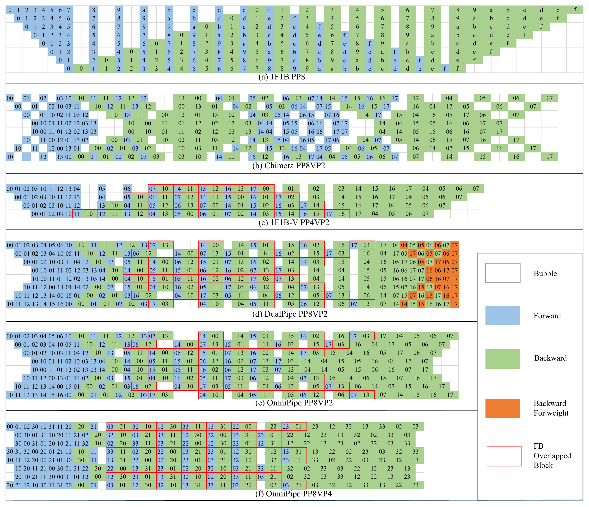
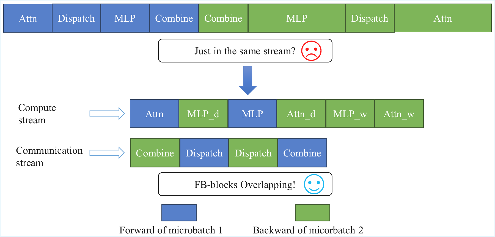

<div align="center">

# OmniPipe

### Efficient, Flexible and Scalable Pipeline Parallelism for Large Model Training

**Jun Li · Zhi Ma · Shigang Li**<br>
Beijing University of Posts and Telecommunications<br>
**ICPP 2026**

[Paper](https://doi.org/10.1145/3832810.3832820) · [Getting Started](#getting-started) · [Experiments](#experiments) · [Citation](#citation)

</div>

OmniPipe is a bidirectional multi-pipeline parallelism framework for training **dense and Mixture-of-Experts (MoE) language models**. Built on Megatron-LM, it jointly reduces pipeline bubbles and per-stage latency by combining configurable pipeline replicas with communication-aware scheduling.

## Highlights

- **Flexible bidirectional pipelines.** Tune the number of pipeline replicas and micro-batches to balance utilization, memory consumption, and communication overhead.
- **Expert communication overlap.** Pair forward and backward work from different micro-batches into FB-blocks, overlapping Expert Parallelism (EP) All-to-All communication with computation.
- **Inter-stage communication overlap.** Decouple input-gradient and weight-gradient computation to overlap pipeline P2P communication with weight-gradient computation.
- **Memory-efficient execution.** Partition optimizer states across data-parallel and pipeline-replica ranks; optionally extend pipeline replicas into the EP dimension to reduce redundant expert parameters.
- **Hybrid parallelism.** Integrate with tensor, pipeline, data, context, and expert parallelism in Megatron-LM.

## Overview

OmniPipe organizes pipeline replicas into forward and reverse directions. A shared cyclic schedule generates FB-blocks, and rank remapping assigns each logical pipeline to the appropriate local model replica. The execution progresses through warm-up, dual BF-blocks, stable FB-blocks, partial FB-blocks, and cool-down.

<table>
  <tr>
    <td width="55%" align="center" valign="middle">
      
    </td>
    <td width="45%" align="center" valign="middle">
      
    </td>
  </tr>
  <tr>
    <td align="center"><em>Pipeline schedule comparison.</em></td>
    <td align="center"><em>EP communication overlap within an FB-block.</em></td>
  </tr>
</table>

*Figures reproduced from the paper. Left: OmniPipe reduces pipeline bubbles with configurable pipeline replicas. Right: blue and green denote forward and backward work from different micro-batches; dispatch and combine run on the communication stream.*

The paper denotes the number of pipeline replicas by **VP**. In this implementation, it is configured with `--virtual-data-parallel-size`. This is distinct from Megatron's virtual pipeline stages, which split a model into interleaved chunks.

## Results

The paper reports experiments on **8, 16, and 32 NVIDIA A800 80 GB GPUs**, comparing OmniPipe with standard 1F1B, interleaved 1F1B, DualPipe, and VZB (Zero Bubble).

| Workload | Reported speedup |
| --- | --- |
| MoE models | **1.12× geometric mean**, up to **1.30×** |
| Dense models | **1.10× average** |

Each schedule is evaluated under its own best configuration from the paper's parallelism search. These are paper-reported results; the small example below is intended to check training setup and does not reproduce those speedups.

## Getting Started

### Environment

Use a **Linux environment with NVIDIA GPUs, CUDA, and NCCL** for distributed training. The paper uses PyTorch **2.6.0**, CUDA **12.4**, and Megatron-LM **core_r0.14.0** on a four-node A800 cluster with NVLink within nodes and InfiniBand across nodes. This checkout identifies its Megatron Core package as **0.14.1**.

Python **3.10 or newer** is required by the package metadata. Install a CUDA-enabled PyTorch build appropriate for your cluster before installing this repository. Transformer Engine is required for the example below; its installation requires a compatible CUDA toolchain. See [pyproject.toml](pyproject.toml) for the dependency groups shipped with this checkout.

### Installation

```bash
git clone https://github.com/ParCIS/OmniPipe.git
cd OmniPipe

# Run inside an environment with CUDA-enabled PyTorch already installed.
python -m pip install "setuptools<80" pybind11 packaging "numpy<2"
python -m pip install --no-build-isolation -e ".[mlm,lts]"
python -m pip install --no-build-isolation "transformer-engine[pytorch]>=2.6.0a0,<2.8.0"
python -m pip install debugpy

# Use the training code and modified Megatron Core from this checkout.
export PYTHONPATH="${PWD}:${PYTHONPATH}"
```

`debugpy` is currently imported by the OmniPipe module even when debugging is disabled. Install this fork from source so that the training entry point uses the OmniPipe implementation.

### Small MoE training example

The following single-node example uses **8 GPUs**, synthetic data, **PP=4**, **VP=2**, and **EP=2**. It requires no downloaded dataset or tokenizer. It is a setup example, not a paper benchmark, and has not been validated with a distributed GPU run in this documentation update.

```bash
# Allow communication and computation to use multiple CUDA connections.
export CUDA_DEVICE_MAX_CONNECTIONS=8
export EXTEND_VDP_TO_EP=false

torchrun --standalone --nproc_per_node=8 pretrain_gpt.py \
    --tensor-model-parallel-size 1 \
    --pipeline-model-parallel-size 4 \
    --virtual-data-parallel-size 2 \
    --multi-pipeline-type omnipipe \
    --expert-model-parallel-size 2 \
    --num-layers 8 \
    --hidden-size 512 \
    --ffn-hidden-size 1536 \
    --num-attention-heads 8 \
    --seq-length 512 \
    --max-position-embeddings 512 \
    --num-experts 8 \
    --moe-router-topk 1 \
    --moe-router-load-balancing-type aux_loss \
    --moe-aux-loss-coeff 1e-2 \
    --moe-token-dispatcher-type alltoall \
    --moe-grouped-gemm \
    --overlap-moe-expert-parallel-comm \
    --transformer-impl transformer_engine \
    --use-distributed-optimizer \
    --no-gradient-accumulation-fusion \
    --bf16 \
    --micro-batch-size 1 \
    --global-batch-size 32 \
    --train-iters 10 \
    --lr 1e-4 \
    --min-lr 1e-5 \
    --lr-decay-style constant \
    --weight-decay 0.1 \
    --clip-grad 1.0 \
    --mock-data \
    --tokenizer-type NullTokenizer \
    --vocab-size 4096 \
    --split 100,0,0 \
    --eval-iters 0 \
    --log-interval 1
```

For multi-node runs, replace `--standalone` with the cluster's `--nnodes`, `--node_rank`, `--master_addr`, and `--master_port` settings, keeping the training arguments consistent across ranks.

### Key configuration options

| Option | Purpose |
| --- | --- |
| `--multi-pipeline-type omnipipe` | Select OmniPipe when multi-pipeline execution is enabled. |
| `--virtual-data-parallel-size` | Set the number of pipeline replicas (VP in the paper). |
| `--pipeline-model-parallel-size` | Set the number of physical pipeline stages (PP). |
| `--expert-model-parallel-size` | Set the base expert-parallel group size (EP). |
| `--overlap-moe-expert-parallel-comm` | Enable EP communication/computation overlap within FB-blocks. |
| `--use-distributed-optimizer` | Enable distributed optimizer-state partitioning. |
| `EXTEND_VDP_TO_EP=true` | Extend the EP group across pipeline replicas to reduce expert parameter replication. |

Use compatible replica counts such as **VP=2 or VP=4**, with **PP divisible by VP**. The schedule divides micro-batches evenly across replicas, so the micro-batch count must also be divisible by VP. Layer counts must permit an even partition across PP stages. The micro-batch count comes from global batch size, micro-batch size, and Megatron's configured data-parallel size; it is not a separate launch argument.

Do not combine OmniPipe replicas with `--num-layers-per-virtual-pipeline-stage` or `--num-virtual-stages-per-pipeline-rank`: the schedule dispatcher selects Megatron's interleaved schedule when virtual pipeline stages are configured.

EP overlap requires **EP > 1**, BF16 or FP16, and an `alltoall` or `flex` token dispatcher. The implementation disallows full recomputation and shared-expert overlap on this path. When combining tensor and expert parallelism, enable `--sequence-parallel`. If the generated schedule has no stable overlap blocks, the scheduler disables EP overlap for that configuration.

For **Extend-VP-to-EP**, set `EXTEND_VDP_TO_EP=true` on every rank. The implementation reads this environment variable in both process-group initialization and model configuration, and expands the effective EP size to `EP × VP`; choose an expert count divisible by that size. The parsed `--extend-vdp-to-ep` flag alone does not activate this path in the current code.

### Training with real data

Prepare a JSONL corpus with a `text` field per record, then use the preprocessing utility to create Megatron indexed datasets:

```bash
python tools/preprocess_data.py \
    --input /path/to/corpus.jsonl \
    --output-prefix /path/to/processed/corpus \
    --tokenizer-type GPT2BPETokenizer \
    --vocab-file /path/to/vocab.json \
    --merge-file /path/to/merges.txt \
    --append-eod \
    --workers 8
```

Replace `--mock-data`, `--tokenizer-type NullTokenizer`, and `--vocab-size` in the training example with matching tokenizer arguments and `--data-path /path/to/processed/corpus_text_document`. Set an appropriate train/validation/test split and evaluation interval for your dataset.

The inherited [Mixtral example](examples/mixtral/train_mixtral_8x7b_distributed.sh) is a reference for model and tokenizer settings. It uses top-2 routing and does not enable OmniPipe by default, so it is not the paper's top-1 MoE reproduction script; its parallelism configuration must also be adapted to your GPU allocation.

## Experiments

### Paper configurations

All MoE configurations below use **8 experts**, **top-1 routing**, and **micro-batch size 1**.

| GPUs | Model size | Layers | Hidden size | MoE FFN hidden size | Sequence length | Global batch size |
| --- | --- | --- | --- | --- | --- | --- |
| 8 | 6B | 32 | 2048 | 3072 | 8192 | 16 |
| 16 | 12B | 32 | 4096 | 3072 | 8192 | 32 |
| 32 | 16B | 48 | 2048 | 6144 | 4096 | 64 |

The dense evaluation uses a **5.6B Transformer** with **32 layers**, hidden size **4096**, and FFN hidden size **8192**.

The paper measures average end-to-end training iteration time in milliseconds and searches valid `(PP, DP, EP, VP)` configurations under a fixed GPU budget. Unless otherwise specified, it uses `2 × PP` micro-batches when feasible. To compare schedules, keep model, precision, data, sequence length, and global batch size fixed, and tune each schedule within its valid configuration space.

This checkout contains the training implementations and inherited Megatron examples. It does not currently include an OmniPipe-specific end-to-end configuration-search script or the raw experiment logs used to generate the paper's figures.

## Code Structure

```text
OmniPipe/
├── pretrain_gpt.py                         # Dense/MoE language-model training
├── megatron/
│   ├── core/
│   │   ├── pipeline_parallel/
│   │   │   ├── omnipipe/
│   │   │   │   ├── __init__.py             # Schedule entry point and overlap patches
│   │   │   │   ├── auto_schedule.py        # Cyclic schedule generation and rank mapping
│   │   │   │   ├── scheduler.py            # Forward/backward execution runtime
│   │   │   │   └── communication.py        # Pipeline P2P communication
│   │   │   ├── dualpipe/                   # DualPipe implementation
│   │   │   ├── zerobubble/                 # Zero Bubble implementation
│   │   │   └── schedules.py                # Schedule selection and Megatron schedules
│   │   ├── parallel_state.py              # Process groups and replica/EP mapping
│   │   └── models/common/
│   │       └── model_chunk_schedule_plan.py # Fine-grained model execution plans
│   └── training/
│       ├── arguments.py                   # Training and OmniPipe options
│       └── training.py                    # Model construction and training loop
├── examples/                              # Inherited model training examples
├── tools/preprocess_data.py               # Indexed-dataset preprocessing
├── tests/                                 # Megatron tests, including A2A overlap tests
└── docs/assets/                           # README figure assets
```

## Citation

If you use OmniPipe in your research, please cite:

```bibtex
@inproceedings{li2026omnipipe,
  author    = {Jun Li and Zhi Ma and Shigang Li},
  title     = {{OmniPipe}: Efficient, Flexible and Scalable Pipeline Parallelism for Large Model Training},
  booktitle = {Proceedings of the 55th International Conference on Parallel Processing},
  year      = {2026},
  doi       = {10.1145/3832810.3832820},
  publisher = {Association for Computing Machinery},
  location  = {Singapore, Singapore}
}
```

## Acknowledgments and License

OmniPipe builds on [Megatron-LM](https://github.com/NVIDIA/Megatron-LM) and integrates ideas from bidirectional pipeline scheduling, DualPipe, and Zero Bubble. We thank the authors and contributors of these projects.

See [LICENSE](LICENSE) for the repository's licensing terms. Preserve the copyright notices and any file-specific licenses of the upstream components.
